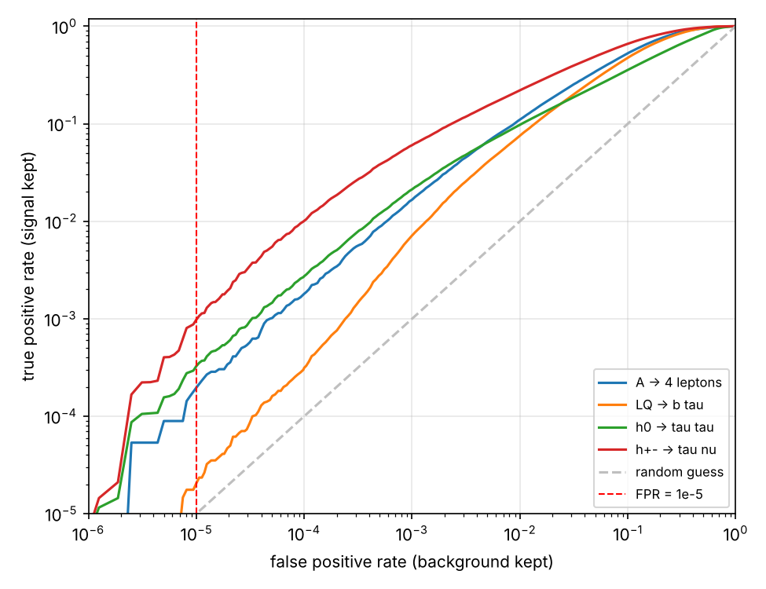
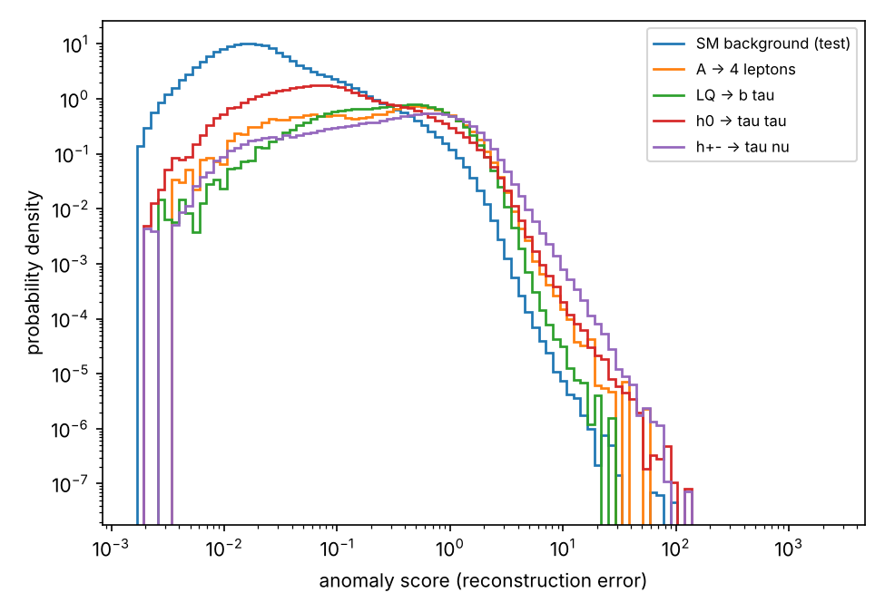
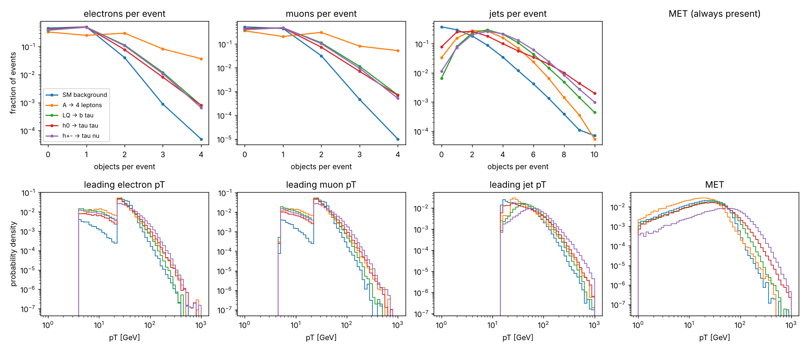

# Anomaly detection on LHC collision data

Unsupervised detection of unusual proton-proton collision events with a small
autoencoder, on the public [ADC2021](https://mpp-hep.github.io/ADC2021/) dataset.

Türkçe açıklama: [README.tr.md](README.tr.md)

**Status: work in progress (started November 2026).** The pipeline, the model,
the evaluation and the tests are in place; four models have been trained and
evaluated on the real dataset, and the gap to the published reference has been
measured but not yet closed; see [Results](#results).

Author: Berke Ekici, Computer Engineering, Mersin University.

## The problem

The LHC collides protons 40 million times per second. Almost all collisions
have to be thrown away within microseconds by the trigger system, and
whatever the trigger does not select is lost. A trigger that only looks for
what theory predicts cannot find the unexpected. The idea studied here: train
a model on ordinary events only, and keep the events it finds hard to
reconstruct.

The ADC2021 challenge provides a simulated stream of Standard Model events
for training and four simulated "new physics" signals for testing. Each event
is described by up to 19 reconstructed objects (missing transverse energy,
4 electrons, 4 muons, 10 jets) with three numbers each (pT, eta, phi), so a
model sees 57 numbers per event. The challenge metric is the true-positive
rate at a false-positive rate of 1e-5.

## Dataset

All files are hosted on Zenodo under CC-BY-4.0.

| Sample | Size | Events in file | Zenodo record |
|---|---|---|---|
| Standard Model background (training) | 646.4 MB | 13,451,915 | [5046428](https://zenodo.org/records/5046428) |
| A -> 4 leptons | 5.4 MB | 55,969 | [7152590](https://zenodo.org/records/7152590) |
| LQ -> b tau | 28.6 MB | 340,544 | [7152599](https://zenodo.org/records/7152599) |
| h0 -> tau tau | 50.2 MB | 691,283 | [7152614](https://zenodo.org/records/7152614) |
| h+- -> tau nu | 65.9 MB | 760,272 | [7152617](https://zenodo.org/records/7152617) |

Event counts were read from the files with `python -m lhcad.explore`. By
default `python -m lhcad.prepare` uses a random subset of 4,000,000 background
events.

## Quick start

Python 3.11, 3.12 or 3.13 is recommended.

```bash
python -m venv .venv
source .venv/bin/activate            # Windows: .venv\Scripts\activate
pip install -r requirements.txt

python -m lhcad.selfcheck            # 30 s, no download: is everything installed?
python -m pytest                     # the automated tests

python -m lhcad.download             # about 800 MB into data/raw/
python -m lhcad.explore data/raw/background_for_training.h5
python -m lhcad.prepare              # data/processed/*.npy (about 1.3 GB)
python -m lhcad.train --name baseline
python -m lhcad.evaluate --run runs/baseline
python -m lhcad.compare              # all evaluated runs as a Markdown table
```

If the download script fails on your network, download the five files from
the record pages in the table above into `data/raw/` and continue with
`python -m lhcad.prepare`.

No local setup: the notebook
[notebooks/reproduce_baseline.ipynb](notebooks/reproduce_baseline.ipynb) runs
the same steps on a free Google Colab machine.

[](https://colab.research.google.com/github/berkeekicii/lhc-anomaly-detection/blob/main/notebooks/reproduce_baseline.ipynb)

Resources, measured on a 2-core machine with fake data of the same size as
the real dataset: preparing 4 million events takes about 10 s and 1.5 GB of
memory, training on 2 million events about 5 s per epoch and 2 GB, evaluation
about 5 s. No GPU is needed. With less than 8 GB of RAM use
`python -m lhcad.prepare --max-events 1000000`.

## How it works

| Step | Module | What it does |
|---|---|---|
| Download | `lhcad/download.py` | Fetches the files from Zenodo and verifies their checksums. |
| Explore | `lhcad/explore.py` | Prints the file structure, an example event and object statistics; checks the slot layout. |
| Prepare | `lhcad/prepare.py` | Reads the HDF5 files block by block, keeps (pT, eta, phi), shuffles and splits the background 50% / 10% / 40% into train / validation / test. |
| Scale | `lhcad/data.py` | `Scaler` brings the inputs to a similar size. Three options: `quantity` (default), `feature`, `none`. |
| Model | `lhcad/model.py` | Dense autoencoder 57 -> 32 -> 16 -> 3 -> 16 -> 32 -> 57 with batch normalisation and leaky ReLU, 5,122 parameters. |
| Train | `lhcad/train.py` | Adam, mean squared error, early stopping on the validation loss. `--masked-loss` counts only the object slots that are filled; `--device` picks CPU or GPU. |
| Evaluate | `lhcad/evaluate.py` | Anomaly score = reconstruction error. AUC and TPR at FPR 1e-3, 1e-4 and 1e-5 per signal; ROC and score plots. |
| Compress | `lhcad/compress.py` | Prunes and quantizes a trained model, then measures AUC, latency and size for each variant. |
| Export | `lhcad/export.py`, `lhcad/figures.py` | Copies the small result files of a run (metrics, weights, reduced curves) into `results/` and draws the figures from them. |
| Compare | `lhcad/compare.py` | Prints every evaluated run as one Markdown table. |
| Check | `lhcad/selfcheck.py`, `lhcad/synthetic.py` | Runs everything on fake events in the same file format. Fake events are for testing only. |

## Results

Published reference (Govorkova et al., Table I, floating-point DNN autoencoder,
reconstruction-error score):

| | A -> 4 leptons | LQ -> b tau | h0 -> tau tau | h+- -> tau nu |
|---|---|---|---|---|
| AUC | 0.96 | 0.95 | 0.87 | 0.96 |
| TPR at FPR 1e-5 | 3.56% | 0.05% | 0.09% | 0.06% |

This repository, first baseline (`python -m lhcad.train --name baseline`,
one run, seed 0; trained on 2,000,000 background events for 20 epochs,
tested on 1,600,000 background events; run on a free Google Colab CPU with
[the notebook](notebooks/reproduce_baseline.ipynb)):

| | A -> 4 leptons | LQ -> b tau | h0 -> tau tau | h+- -> tau nu |
|---|---|---|---|---|
| AUC | 0.855 | 0.843 | 0.750 | 0.894 |
| TPR at FPR 1e-3 | 1.660% | 0.714% | 2.125% | 6.032% |
| TPR at FPR 1e-4 | 0.180% | 0.031% | 0.273% | 1.010% |
| TPR at FPR 1e-5 | 0.020% | 0.002% | 0.033% | 0.098% |

At FPR 1e-5 only 16 background test events lie above the threshold, so the
last row is a rough estimate. All files of this run, including the trained
weights, are in [results/baseline/](results/baseline/).

### Closing the gap to the reference

Three of the differences listed above were removed one at a time
(`bash scripts/close_the_gap.sh`), to see which of them the gap is made of.
AUC per signal:

| Run | What changed | A -> 4 leptons | LQ -> b tau | h0 -> tau tau | h+- -> tau nu |
|---|---|---|---|---|---|
| [baseline](results/baseline/) | 20 epochs, 2M train events | 0.855 | 0.843 | 0.750 | 0.894 |
| [long](results/long/) | train until the validation loss stops improving | 0.856 | 0.846 | 0.753 | 0.897 |
| [long-masked](results/long-masked/) | and ignore empty object slots in the loss | 0.798 | 0.800 | 0.733 | 0.879 |
| [long-masked-8m](results/long-masked-8m/) | and use 8M instead of 4M background events | 0.803 | 0.802 | 0.735 | 0.881 |
| reference | Govorkova et al., Table I | 0.96 | 0.95 | 0.87 | 0.96 |

### How large does a difference have to be?

The `long` setting was repeated with four random seeds
([results/long](results/long/), [-seed1](results/long-seed1/),
[-seed2](results/long-seed2/), [-seed3](results/long-seed3/);
`python scripts/seed_summary.py results/long results/long-seed*`):

| | A -> 4 leptons | LQ -> b tau | h0 -> tau tau | h+- -> tau nu |
|---|---|---|---|---|
| mean AUC | 0.852 | 0.842 | 0.748 | 0.894 |
| standard deviation | 0.007 | 0.007 | 0.007 | 0.005 |
| range over 4 seeds | 0.844 - 0.859 | 0.834 - 0.850 | 0.741 - 0.755 | 0.889 - 0.900 |

Changing only the seed moves the AUC by about 0.007. That is the yardstick for
the table above:

* **longer training does nothing**: the difference between `baseline` and
  `long` is 0.001 to 0.004, which is 0.2 to 0.6 times the seed spread, so it
  is noise. An earlier version of this file called it a small improvement;
  that claim did not survive the repeat;
* **more data does nothing either**: `long-masked-8m` over `long-masked` is
  0.002 to 0.005, also inside the noise;
* **masking the empty slots really does hurt**: 0.015 to 0.054 below the
  4-seed mean, which is 2.2 to 7.8 times the spread.

So the gap to the reference is not explained by training length, data size or
the masked loss. The remaining differences, and the first candidates for the
next experiments, are the reference's input normalisation and its separate
treatment of eta and phi in the loss. Every number quoted elsewhere in this
file comes from a single seed and carries this same +-0.007.

### How much of this is just counting objects?

Signal events contain more objects than background events: 6.2, 5.7, 4.8 and
5.9 objects on average for the four signals, against 3.3 for the background.
A "detector" that looks at nothing but the number of jets in an event
(`python scripts/object_count_baseline.py results/long`) already reaches:

| | A -> 4 leptons | LQ -> b tau | h0 -> tau tau | h+- -> tau nu |
|---|---|---|---|---|
| jet count alone | 0.802 | 0.865 | 0.735 | 0.873 |
| autoencoder (`long`) | 0.856 | 0.846 | 0.753 | 0.897 |

So most of the separation comes from object multiplicity, and for LQ -> b tau
counting jets alone does better than the autoencoder. This also explains the
masking result: an empty slot is exactly the signal that an object is missing,
so a loss that skips empty slots throws that information away. Any claim that
the model has learned something beyond multiplicity has to be measured against
this trivial baseline.

### Making the model smaller and faster

A trigger has microseconds, so a model is only useful if it is small and fast.
Three cheaper versions of the `long` model were measured
(`python -m lhcad.compress --run runs/long`, one CPU thread,
[results/long/compression.json](results/long/compression.json)):

| Variant | Weight bytes | Non-zero bytes | us/event, one event at a time | us/event, batches of 1000 | A -> 4 leptons | LQ -> b tau | h0 -> tau tau | h+- -> tau nu |
|---|---|---|---|---|---|---|---|---|
| float32 | 20,488 | 20,488 | 245 | 0.7 | 0.856 | 0.846 | 0.753 | 0.897 |
| pruned 50% | 20,488 | 10,952 | 221 | 0.7 | 0.857 | 0.847 | 0.754 | 0.898 |
| pruned 80% | 20,488 | 5,232 | 223 | 0.7 | 0.843 | 0.830 | 0.738 | 0.888 |
| int8 | 6,184 | 4,928 | 490 | 1.3 | 0.812 | 0.677 | 0.704 | 0.838 |

Pruning removes the smallest weights and then fine-tunes the rest for five
epochs. "Weight bytes" is the size on disk and "non-zero bytes" what it would
be if the zeros were dropped; a dense tensor still stores a zero in four
bytes, so only the second column moves when pruning.

* **Half the weights can go for free.** At 50% the AUC is unchanged (the
  differences are ten times smaller than the seed spread), for half the
  non-zero weights.
* **80% costs something real.** 0.009 to 0.016 AUC, about two seed
  deviations, for a quarter of the non-zero weights.
* **8-bit quantization is a bad deal here, twice over.** It loses a lot of
  accuracy, most sharply on LQ -> b tau (0.846 to 0.677), and it is *slower*,
  not faster: 490 us against 245 us per event. For a model this small the
  per-call conversion between floats and integers costs more than the
  arithmetic it saves. Quantization pays off on hardware built for integer
  arithmetic, which a CPU running PyTorch is not.

These times are PyTorch on a Colab CPU, where a single event spends most of
its 245 us inside the framework rather than on the 5,122 multiplications: the
same model in batches of 1000 takes 0.7 us per event, 350 times less. The
reference implementation reaches 80 ns on an FPGA. The comparison between the
rows is meaningful; the absolute numbers say more about PyTorch than about the
model.

| ROC curves | Anomaly score |
|---|---|
|  |  |

How the four signals differ from the background in the input data (first
200,000 events of each file):



The first baseline here is simpler than the reference: plain mean squared
error over all 57 inputs (the paper ignores empty slots and treats eta and phi
separately), one global scaling per quantity (the paper normalises with batch
normalisation), 20 epochs (the paper trains up to 100) and 4 million background
events (the paper uses 8 million). Lower numbers than the reference are
expected at first; measuring and closing that gap is the first part of the
project.

## Project layout

```
lhcad/            the Python package (one module per step, see the table above)
tests/            automated tests, run with "python -m pytest"
notebooks/        reproduce_baseline.ipynb: the whole pipeline on Google Colab
results/          small result files of each published run (metrics, weights, figures)
scripts/          the experiment scripts and the object-count baseline
requirements.txt  the libraries the project needs
data/             created by the download and prepare steps (not in git)
runs/             one folder per trained model (not in git)
```

## Roadmap

1. ~~Reproduce the baseline on the real dataset.~~ Done; the gap to the
   reference is measured and is not explained by training length, data size or
   the masked loss.
2. ~~Repeat the best setting with several random seeds.~~ Done; the spread is
   +-0.007 AUC, which rules out the "longer training helps" reading.
3. ~~Shrink the model and measure latency.~~ Done; half the weights are free,
   8-bit quantization is not worth it on a CPU.
4. Test the two remaining differences to the reference: its input
   normalisation and its separate treatment of eta and phi in the loss.
5. Beat the object-count baseline: is there a model, or an anomaly score, that
   separates the signals by more than event multiplicity?
6. Serve the model behind a small API in a container, with latency measurements.
7. Apply the same method to a second domain (vehicle or electric-bus telemetry).

## Tests

`python -m pytest` runs 48 tests in about 10 seconds. They use small fake files
in the ADC2021 format, so they need neither the dataset nor a network connection.

## References

- E. Govorkova et al., "LHC physics dataset for unsupervised New Physics
  detection at 40 MHz", [arXiv:2107.02157](https://arxiv.org/abs/2107.02157).
  Data format, event selection and sample composition.
- E. Govorkova et al., "Autoencoders on FPGAs for real-time, unsupervised new
  physics detection at 40 MHz at the Large Hadron Collider",
  [arXiv:2108.03986](https://arxiv.org/abs/2108.03986),
  doi:10.1038/s42256-022-00441-3. Reference architecture and results.
- [ADC2021 challenge page](https://mpp-hep.github.io/ADC2021/) and
  [example code](https://github.com/mpp-hep/ADC2021-examplecode) by the organisers.

## License

The code in this repository is released under the MIT License, see
[LICENSE](LICENSE). The dataset is not part of this repository; it is
distributed by its authors on Zenodo under CC-BY-4.0.
