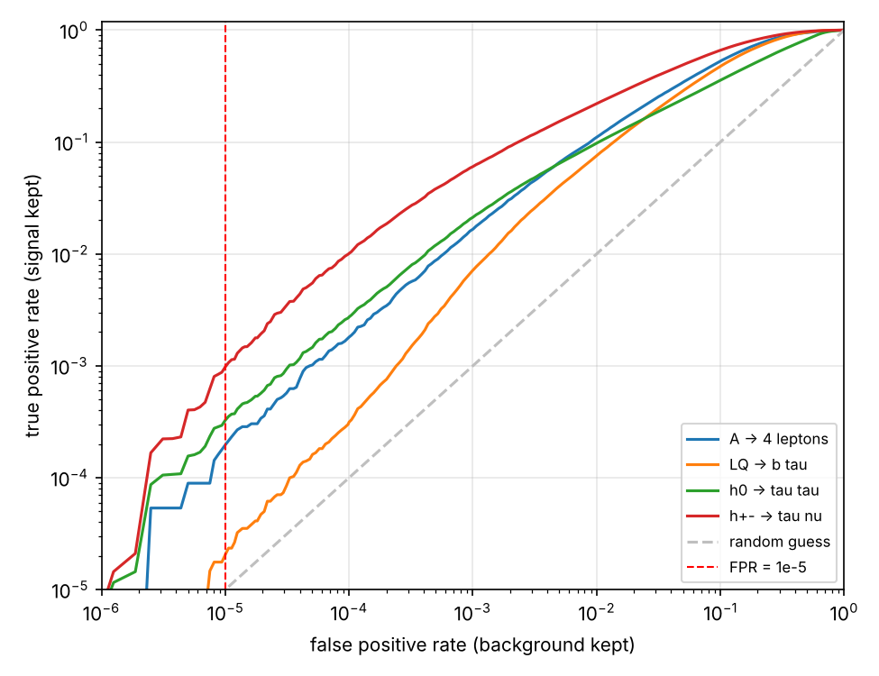
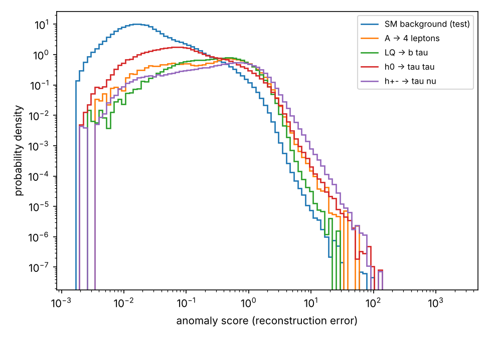
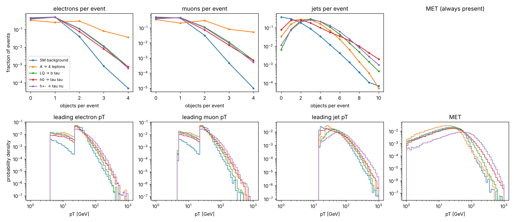

# LHC çarpışma verisinde anomali tespiti

Bu proje, CERN'deki Büyük Hadron Çarpıştırıcısı'nın (LHC) çarpışma olaylarında
"sıra dışı" olanları, ne aradığını önceden bilmeden bulmaya çalışan küçük bir
yapay sinir ağı kuruyor ve ölçüyor.

İngilizce teknik açıklama: [README.md](README.md)

## 1. Problem: bilinmeyeni nasıl ararsın?

LHC saniyede yaklaşık 40 milyon proton çarpışması üretiyor. Bunların hepsini
kaydetmek imkânsız, bu yüzden "tetikleyici" (trigger) denen bir sistem her
çarpışmaya mikro saniyeler içinde bakıp neredeyse hepsini çöpe atıyor. Seçilmeyen
olay sonsuza kadar kayboluyor.

Klasik tetikleyiciler, teorinin öngördüğü belirli işaretleri arar. Ama doğada
henüz kimsenin tahmin etmediği bir "yeni fizik" varsa, ona özel bir kural
yazılmadığı için kaçırılır.

Bu projedeki fikir: bir modele yalnızca sıradan (bilinen fiziğe uyan)
çarpışmaları göster, sıradan olanın neye benzediğini öğrensin. Sonra ona
benzemeyen olayları işaretlesin. Buna **denetimsiz anomali tespiti** denir:
modele hiçbir zaman "bu yeni fizik" diye etiketli örnek verilmez.

## 2. Veri: ADC2021

CERN ve bağlı araştırmacıların bu problem için hazırladığı açık bir veri seti
kullanılıyor (Govorkova ve ark., 2021). Hepsi simülasyon, yani bilgisayarda
fizik kurallarıyla üretilmiş gerçekçi çarpışmalar.

| Dosya | Ne | Olay sayısı |
|---|---|---|
| Arka plan (SM) | Bilinen fizik (W, Z bozonu, top kuark, jet üretimi) | 13.451.915 |
| A → 4 lepton | Varsayımsal yeni bir parçacık | 55.969 |
| LQ → bτ | Leptokuark (varsayımsal) | 340.544 |
| h0 → ττ | Yeni bir Higgs benzeri parçacık | 691.283 |
| h± → τν | Elektrik yüklü Higgs (varsayımsal) | 760.272 |

Her çarpışma (olay) 19 "nesne" ile özetleniyor: 1 kayıp enerji (MET), en fazla
4 elektron, 4 müon ve 10 jet. Her nesnenin 3 sayısı var:

- **pT**: Işın eksenine dik yöndeki momentum, GeV cinsinden. Nesnenin ne kadar "sert" çıktığını gösterir.
- **eta (η)**: Nesnenin ışın eksenine göre açısı.
- **phi (φ)**: Işın etrafındaki açı.

Toplam 19 × 3 = **57 sayı**. Olayda bir nesne yoksa yeri sıfırla doldurulur.

Model eğitilirken yalnızca arka plan kullanılır. Dört sinyal dosyası sadece
sonunda, modelin onları yakalayıp yakalayamadığını ölçmek için kullanılır.

## 3. Model: otokodlayıcı

Otokodlayıcı (autoencoder), girdisini çıktısına kopyalamaya çalışan bir ağdır.
İşin püf noktası ortadaki dar boğaz:

```
57 sayı → 32 → 16 → 3 → 16 → 32 → 57 sayı
         \___ kodlayıcı ___/   \___ kod çözücü ___/
```

Ağ 57 sayıyı 3 sayıya sıkıştırmak, sonra o 3 sayıdan 57 sayıyı geri üretmek
zorunda. Bunu yalnızca sıradan olaylarla öğrendiği için sıradan olayları iyi,
hiç görmediği türden olayları kötü geri üretir.

**Anomali skoru** = girdi ile çıktı arasındaki farkların karelerinin ortalaması
(yeniden yapılandırma hatası). Skor ne kadar büyükse olay o kadar sıra dışı.

Katman boyutları, karşılaştırma yaptığımız makaledeki (Govorkova ve ark., 2022)
modelden alındı. Her katmandan sonra batch normalisation (sayıları dengeler)
ve leaky ReLU (doğrusal olmayan aktivasyon) var.

## 4. Ağırlıklar: ne ve nasıl belirlendi?

Ağın içinde **5.122 öğrenilebilir sayı** (parametre) var. Ağırlıklar, iki katman
arasındaki her bağlantının ne kadar güçlü olduğunu söyleyen sayılardır. Örneğin
ilk katmanda 57 × 32 = 1.824 ağırlık ve 32 sapma (bias) değeri var.

Bu sayıları biz elle seçmedik, **eğitim** belirledi:

1. **Başlangıç:** Ağırlıklar rastgele küçük sayılarla başlar. Rastgelelik
   tohumu (seed) 0, yani aynı komutla her seferinde aynı başlangıç elde edilir.
2. **Deneme:** 1.024 olaylık bir grup ağdan geçirilir, çıktı ile girdi
   arasındaki hata hesaplanır.
3. **Düzeltme:** Adam adlı optimizasyon yöntemi, hatayı azaltacak yönde her
   ağırlığı biraz değiştirir (öğrenme hızı 0,001).
4. **Tekrar:** 2 milyon eğitim olayının hepsi bir kez geçince bir "epoch"
   biter. 20 epoch yapıldı.
5. **Seçim:** Her epoch sonunda, eğitimde hiç görülmemiş 400.000 doğrulama
   olayında hata ölçüldü ve en düşük hatayı veren ağırlıklar saklandı. Bu
   çalıştırmada en iyisi son epoch'tu (hata 0,373'ten 0,283'e düştü).

Eğitilmiş ağırlıklar [results/baseline/model.pt](results/baseline/model.pt)
dosyasında (yaklaşık 30 KB).

Ağırlıklardan ayrı, elle (makaleden ve deneyimden) seçilen ayarlar da var. Bunlara
**hiperparametre** denir: katman boyutları, gizli boyut (3), öğrenme hızı, grup
boyutu (1.024), epoch sayısı (20). Bunları değiştirip sonucu ölçmek projenin
sonraki adımı.

**Girdi ölçekleme:** pT değerleri yüzlerce GeV olabilirken eta ve phi birkaç
birimlik. Ağa vermeden önce her birini kendi ortalama büyüklüğüne bölüyoruz:
pT 19,0 GeV'ye, eta 0,556'ya, phi 0,751'e. Bu sayılar yalnızca eğitim
verisinden hesaplandı ve [results/baseline/scaler.npz](results/baseline/scaler.npz)
dosyasında saklı.

## 5. Kod ne yapıyor?

Her adım `lhcad/` klasöründe ayrı bir dosya:

| Adım | Dosya | Ne yapıyor |
|---|---|---|
| İndir | `download.py` | 5 veri dosyasını Zenodo'dan indirir, bozuk inmediğini sağlama toplamıyla (MD5) kontrol eder. |
| İncele | `explore.py` | Dosyanın yapısını, örnek bir olayı ve nesne istatistiklerini gösterir; biçimin makaleyle uyuştuğunu kontrol eder. |
| Hazırla | `prepare.py` | Arka plandan 4 milyon olay seçer, karıştırır; %50 eğitim, %10 doğrulama, %40 test olarak böler. |
| Ölçekle | `data.py` | Girdileri yukarıda anlatılan şekilde ölçekler. |
| Model | `model.py` | Otokodlayıcının tanımı. |
| Eğit | `train.py` | Ağırlıkları öğrenir, en iyisini saklar. |
| Ölç | `evaluate.py` | Her olaya skor verir, sinyalleri ne kadar ayırdığını hesaplar, grafik çizer. |
| Karşılaştır | `compare.py` | Farklı çalıştırmaların sonuçlarını tek tabloda gösterir. |
| Dışa aktar | `export.py`, `figures.py` | Sonuçları `results/` klasörüne kopyalar ve grafikleri çizer. |
| Kontrol | `selfcheck.py`, `synthetic.py` | Her şeyi sahte veriyle hızlıca dener (sadece test için). |

`tests/` klasöründeki 40 otomatik test, kodun her parçasının doğru çalıştığını
kontrol ediyor.

Bilgisayar kurmadan çalıştırmak için:
[notebooks/reproduce_baseline.ipynb](notebooks/reproduce_baseline.ipynb)
dosyası tüm adımları Google Colab'de yaklaşık 10 dakikada çalıştırıyor.

## 6. Sonuçlar: ne elde ettik?

İki ölçü kullanıyoruz:

- **AUC:** Rastgele bir sinyal olayının skorunun, rastgele bir arka plan
  olayınınkinden yüksek olma olasılığı. 0,5 yazı tura, 1,0 kusursuz ayrım.
- **FPR'de TPR:** Eşiği öyle koy ki arka plan olaylarının yalnızca belli bir
  kısmı (örneğin binde biri) geçsin; sinyalin yüzde kaçı geçiyor? Gerçek bir
  tetikleyici çok az arka plan tutabildiği için asıl önemli ölçü bu.

| | A → 4 lepton | LQ → bτ | h0 → ττ | h± → τν |
|---|---|---|---|---|
| AUC (bizim) | 0,855 | 0,843 | 0,750 | 0,894 |
| AUC (makale) | 0,96 | 0,95 | 0,87 | 0,96 |
| Binde 1 arka planda yakalanan sinyal | %1,66 | %0,71 | %2,13 | %6,03 |

Bu sonuçlardan çıkanlar:

1. **Yöntem çalışıyor.** Model hiç sinyal görmeden dört senaryonun hepsini
   şansın açıkça üstünde ayırıyor. Örneğin h± → τν için: arka plan olaylarının
   yalnızca binde birini tutan bir eşikte sinyal olaylarının yüzde 6'sı
   yakalanıyor, yani sinyal 60 kat zenginleşiyor.
2. **Henüz makalenin gerisindeyiz.** AUC farkı 0,07–0,12. Makale daha uzun
   eğitiyor (100 epoch'a kadar), boş yuvaları hata hesabına katmıyor ve 8 milyon
   olay kullanıyor. Bizde doğrulama hatası 20. epoch'ta hâlâ düşüyordu, yani
   eğitim yarım kaldı.
3. **Neden ayırabiliyor, grafikten görülüyor.** Aşağıdaki girdi grafiğinde,
   sinyallerde arka plana göre daha fazla lepton, daha fazla jet ve daha yüksek
   kayıp enerji var. Model bu farkları açıkça söylenmeden kendisi buluyor.
4. **En zor sinyal h0 → ττ** (AUC 0,750). Nedenini anlamak, sonraki
   deneylerin konularından biri.

| ROC eğrileri | Anomali skoru dağılımı |
|---|---|
|  |  |

ROC grafiğinde her eğri ne kadar yukarıdaysa o kadar iyi. Gri kesikli çizgi
yazı tura. Skor grafiğinde mavi (arka plan) solda toplanırken sinyaller sağa
kayıyor: model sinyalleri daha kötü geri üretiyor.



**Sınırlamalar:** Bu tek bir çalıştırma (tek tohum). En sıkı ölçüde (yüz binde
bir arka plan) eşiğin üstünde yalnızca 16 arka plan olayı kaldığı için o
sütundaki sayılar kaba tahmin. Tüm veri simülasyon.

## 7. Sırada ne var?

1. Daha uzun eğitim ve farklı tohumlarla tekrar, sonuçların ne kadar oynadığını görmek.
2. Ölçekleme yöntemi, gizli boyut ve boş yuvaları saymayan bir hata ile deneyler.
3. Modeli küçültmek (kuantizasyon, budama) ve hız ölçmek: gerçek tetikleyicide
   karar mikro saniyelerde verilmek zorunda.
4. Modeli küçük bir servis olarak sunmak.
5. Aynı yöntemi başka bir alana uygulamak (araç veya elektrikli otobüs verisi).

## Kaynaklar

- E. Govorkova ve ark., "LHC physics dataset for unsupervised New Physics
  detection at 40 MHz", [arXiv:2107.02157](https://arxiv.org/abs/2107.02157).
- E. Govorkova ve ark., "Autoencoders on FPGAs for real-time, unsupervised new
  physics detection at 40 MHz at the Large Hadron Collider",
  [arXiv:2108.03986](https://arxiv.org/abs/2108.03986).
- [ADC2021 yarışma sayfası](https://mpp-hep.github.io/ADC2021/)
